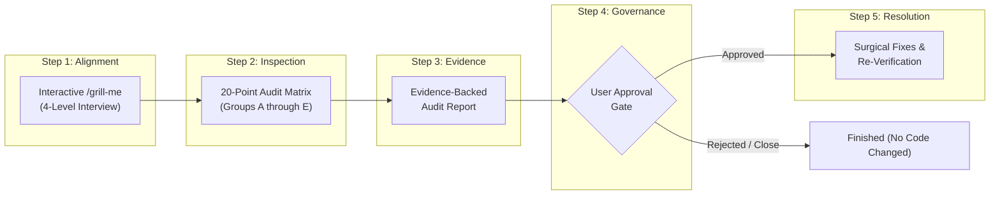
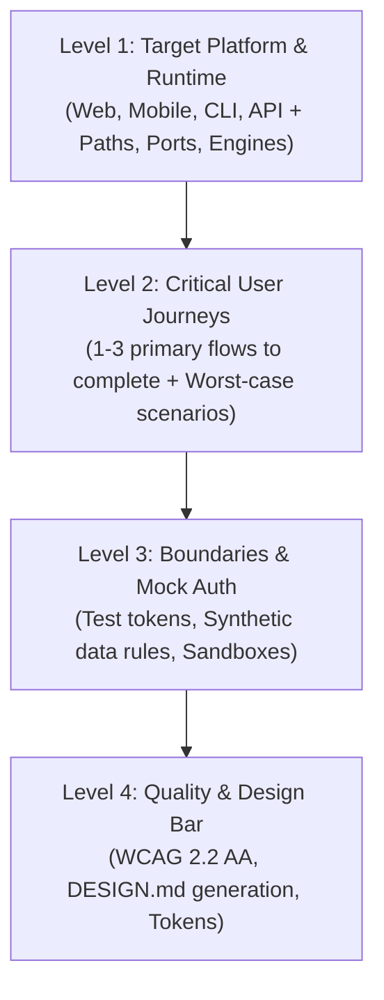

<div align="center">

# Product Inspector

**Universal Pre-Release Quality, UX & Security Audit Agent Skill**

An enterprise-grade QA inspection skill for AI coding assistants. Conducts interactive, multi-stage interviews and executes an evidence-backed 20-point verification suite across Web, Mobile/Desktop Apps, CLI binaries, and Backend APIs before shipping to production.

[](LICENSE)
[](https://www.w3.org/WAI/standards-guidelines/wcag/)
[](#supported-targets)
[](#strict-safety-guardrails)

[Features](#key-capabilities) • [Audit Matrix](#20-point-audit-matrix) • [Workflow](#how-it-works) • [Installation](#installation) • [Report Example](#sample-audit-report)

---

</div>

## Overview

Most AI agents jump directly to modifying files, often introducing breaking regressions or proposing untested fixes. **Product Inspector** enforces a professional Quality Assurance discipline:

1. **Grill-Me Protocol**: Conducts an interactive 4-stage interview to map targets, boundaries, and critical failure modes.
2. **Strict Read-Only Audit**: Explores, tests, and documents defects without modifying source code, running live transactions, or polluting repositories.
3. **Evidence-Based Reporting**: Demands reproducible logs, HTTP codes, exit codes, and screenshot references for every detected defect.
4. **Surgical Remediation**: Halts automatically and awaits explicit user approval before executing verified, localized patches.

---

## Key Capabilities

- **Universal Target Support**: Seamlessly audits Web SPAs/SSRs, mobile/desktop shells, CLI executables, and HTTP/REST/GraphQL APIs.
- **Interactive Multi-Level Interview**: Uses structured multiple-choice grilling to determine runtime environments, mock boundaries, and user journeys.
- **WCAG 2.2 AA Compliance**: Evaluates color contrast ratios (>= 4.5:1), touch targets (>= 44x44px), font zoom resilience (200%), and keyboard focus traps.
- **Fail-Safe Testing Boundaries**: Enforces synthetic/mock data only. Never uses production secrets, real accounts, or live financial transactions.
- **Surgical Post-Approval Fixes**: Fixes only explicitly approved items (`ISS-01`, `ISS-02`), followed by immediate re-verification.

---

## Supported Targets

| Target Domain | Focus Areas | Key Verification Tools |
|---|---|---|
| **Web Applications** | Responsive layout, accessibility, console errors, broken routes, modals, hydration | Chrome DevTools MCP, headless browser, DOM inspection |
| **CLI & Terminal Tools** | Arguments parsing, `--help`, exit codes, STDOUT vs STDERR, pipe handling, ANSI colors | Terminal execution, shell commands, mocked stdin |
| **APIs & Microservices** | Payload schema validation, status codes (2xx/4xx/5xx), auth error handling, latency | curl, HTTP client scripts, JSON schema validator |
| **Desktop / Mobile Apps** | Window resizing, system tray, keyboard accelerators, packaging integrity | Screen capture, process monitoring, IPC diagnostics |

---

## How It Works



---

## 4-Level Grill-Me Onboarding

Before initiating an inspection, Product Inspector walks down a 4-level design tree to clarify constraints:



---

## 20-Point Audit Matrix

The audit suite evaluates 20 standardized inspection checkpoints divided into 5 core groups:

### Group A: Design & Interface Consistency
- `01. Design Foundation & Tokens` — Typography scales, palettes, spacing, corner radius.
- `02. Visual Hierarchy & Contrast` — WCAG 2.2 AA contrast ratios (>= 4.5:1 text, >= 3:1 graphical).
- `03. Component Predictability` — Consistent paddings, card structures, input outlines, and CTA styling.
- `04. Density & Clutter` — Balanced whitespace and distinct focal points.
- `05. Theme Integrity` — Dark/light mode consistency without text or border dropouts.

### Group B: Responsiveness & Environment Adaptability
- `06. Viewport & Terminal Overflow` — Horizontal scroll detection across 320px–1024px or 80-column CLI wrap.
- `07. Navigation Systems` — Responsive drawer, mobile hamburger, dropdowns, and nested subcommands.
- `08. Ergonomics & Touch Targets` — Minimum 44x44px clickable areas for touch interactions.
- `09. Zoom & Font Scaling` — Layout survivability at 200% browser zoom or large system fonts.

### Group C: State Management & Resilience
- `10. Pending & Loading Indicators` — Skeletons, spinners, or CLI progress indicators for latency states.
- `11. Empty States & Guidance` — Actionable zero-data screens, clear next steps for users.
- `12. Interactive States` — Comprehensive states for interactive elements (Default, Hover, Active, Disabled).
- `13. Inline Validation & Feedback` — Field-level contextual errors and unambiguous operation toasts.
- `14. Overlay & Dialog Traps` — Focus management, `Esc` dismissibility, backdrop handling, and scroll lock.

### Group D: Critical Journey & Accessibility (E2E)
- `15. Critical Path Simulation` — End-to-end journey execution using synthetic data.
- `16. Dead Ends & Broken Routes` — 404 links, unhandled buttons, missing back navigation, uncaught exits.
- `17. Keyboard-Only Navigation` — Complete navigability via `Tab`/`Enter`/`Space` with visible focus rings.

### Group E: Production Readiness & Hygiene
- `18. 5-Second Value Proposition` — Clear messaging communicating the product's primary utility immediately.
- `19. Primary Action Focus` — Single prominent call-to-action per view preventing user hesitation.
- `20. Cleanliness & Metadata` — Zero unhandled console exceptions, favicons, meta tags, no placeholder text.

---

## Strict Safety Guardrails

> [!IMPORTANT]
> **Zero File Modifications during Inspection**: The initial audit is strictly read-only.
> - No files will be modified, created, or deleted.
> - No git commits or branches will be created.
> - No code will be deployed to staging or production.
> - No real customer records, real payment details, or production credentials will be utilized.

---

## Sample Audit Report

```markdown
# Pre-Release Quality Audit Report

## 1. Executive Summary
- Passed: 16 items
- Issues Found: 3 items (High: 1, Medium: 1, Low: 1)
- Untested: 1 item (External OAuth - requires sandbox credentials)

## 2. Verified Defects
| ID | Priority | Surface / Path | Defect Observed | Evidence | User Impact | Recommended Remediation |
|---|---|---|---|---|---|---|
| ISS-01 | High | `/checkout` | Submit button fails to trigger on form completion | Console error: `TypeError: Cannot read properties of undefined` | User cannot complete checkout | Add optional chaining and null check in `validatePayment()` |
| ISS-02 | Medium | `/login` | Password field lacks focus outline | DOM audit: `outline: none` without replacement | Keyboard users cannot verify focus position | Add `:focus-visible` ring using design tokens |
| ISS-03 | Low | `Navbar.tsx` | Mobile hamburger icon missing ARIA label | Screen reader trace: nameless button element | Impairs accessibility for screen readers | Add `aria-label="Toggle navigation menu"` |

## 3. Remediation Roadmap
1. [ISS-01] Fix payment validation error -> Target file: `src/features/checkout/CheckoutForm.tsx`
2. [ISS-02] Add focus-visible styling -> Target file: `src/styles/components/input.css`
3. [ISS-03] Supply accessible label -> Target file: `src/components/common/Navbar.tsx`
```

---

## Installation

### Method 1: Local Installation (Antigravity & Gemini CLI)

Clone or copy the `product-inspector` skill directly into your local configuration directory:

```bash
# Windows PowerShell
New-Item -ItemType Directory -Force -Path "$HOME\.gemini\config\skills\product-inspector"
Copy-Item -Path "skills\product-inspector\SKILL.md" -Destination "$HOME\.gemini\config\skills\product-inspector\SKILL.md"

# macOS / Linux
mkdir -p ~/.gemini/config/skills/product-inspector
cp skills/product-inspector/SKILL.md ~/.gemini/config/skills/product-inspector/SKILL.md
```

### Method 2: Usage in Conversation

Invoke the skill directly in any chat session:

```text
@product-inspector ช่วยตรวจสอบโปรเจกต์นี้ก่อนปล่อยขึ้น Production
```
or invoke with `/grill-me`:
```text
ใช้ skill product-inspector ร่วมกับ /grill-me เพื่อตรวจสอบเว็บไซต์นี้
```

---

## License

Distributed under the [MIT License](LICENSE). Contributions, suggestions, and issue reports are welcome!
